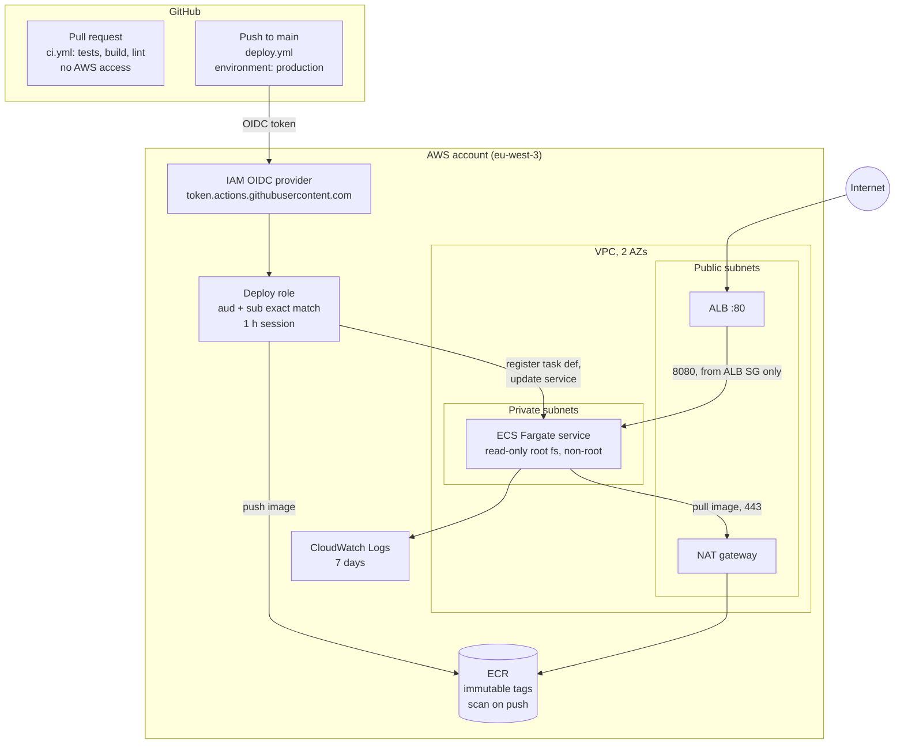

# GitHub Actions to AWS ECS, with no stored AWS keys

A working reference for deploying a container from GitHub Actions to AWS ECS
Fargate using OpenID Connect (OIDC) instead of AWS access keys. Everything is
Terraform; every permission is scoped and explained.

## Problem

Most CI pipelines deploy to AWS with an IAM user's access key saved as a
GitHub secret. That key never expires, often has broad rights, and anyone who
can edit a workflow (or leak its logs) can use it.

## Result

- **No AWS keys anywhere.** GitHub requests a short-lived token per job; AWS
  exchanges it for credentials that expire within one hour.
- **Only one place can deploy.** The AWS role trusts exactly this repository
  *and* the `production` environment, which only `main` can use. Pull
  requests, other branches and forks are refused.
- **The deploy role can do one job.** Push to one ECR repository, update one
  ECS service, and pass two specific roles to ECS. Nothing else.
- **Proven, not claimed.** A separate workflow tries to assume the role from
  outside the environment and passes only if AWS answers `AccessDenied`.

## Architecture



Deploy flow: build the image, tag it with the commit SHA, push it, copy the
current task definition, swap in the new image, register it as a new
revision, update the service, and wait until ECS reports it stable. A rollout
that never gets healthy is rolled back automatically (deployment circuit
breaker).

## Security decisions

| Decision | Why | Where |
|---|---|---|
| OIDC federation, no IAM user | Nothing long-lived to leak or rotate | `terraform/bootstrap/main.tf` |
| Trust on `aud` and `sub` with `StringEquals`, no wildcards | Only this repo's `production` environment can assume the role | `terraform/infra/iam_deploy.tf`, [docs/trust-policy.md](docs/trust-policy.md) |
| `production` environment limited to `main`, branch protection on `main` | Makes the `sub` condition mean "reviewed code on main" | [docs/RUNBOOK.md](docs/RUNBOOK.md) step 3 |
| 1-hour maximum session | Stolen credentials expire quickly | `iam_deploy.tf` |
| Deploy role scoped to one ECR repo and one ECS service | A compromised workflow cannot touch anything else | `iam_deploy.tf` |
| `iam:PassRole` only for the two task roles, only to `ecs-tasks.amazonaws.com` | Blocks using the deploy role to hand privileges to EC2, Lambda, etc. | `iam_deploy.tf` |
| Role ARN and region as GitHub *variables*, not secrets | They are not sensitive; there is no secret to store | `deploy.yml` |
| PR workflow has no `id-token` permission and no secrets | Untrusted PR code never gets near AWS | `ci.yml` |
| Every action pinned to a full commit SHA | A moved or compromised tag cannot change what runs | `.github/workflows/` |
| Execution role with a scoped inline policy instead of the AWS managed one | Pull from this repository and write to this log group only | `iam_task.tf` |
| Task role with no permissions | The app does not call AWS | `iam_task.tf` |
| Tasks in private subnets, no public IP, ingress from the ALB only, egress 443 only | Containers are not reachable from the internet | `ecs.tf` |
| Read-only root filesystem, UID 10001, all Linux capabilities dropped | Limits what an exploited app process can do | `ecs.tf`, `app/Dockerfile` |
| ECR immutable tags + scan on push | The SHA tag always means the same image; known CVEs are flagged | `ecr.tf` |
| ALB drops invalid HTTP headers | Reduces request smuggling risk | `alb.tf` |
| S3 state with versioning, encryption, TLS-only policy and native locking | Recoverable, private state with no DynamoDB table | `terraform/bootstrap/main.tf` |
| Monthly budget alerts | Cost guardrail for a demo account | `terraform/bootstrap/main.tf` |

Scanner exceptions (Checkov) are commented inline next to each resource with
the reason, for example HTTP-only because this demo has no domain or
certificate.

### What a production setup adds

HTTPS with an ACM certificate and an HTTP-to-HTTPS redirect, WAF, one NAT
gateway per AZ or VPC endpoints for ECR/S3/Logs, ALB access logs, KMS keys,
required reviewers on the `production` environment, and two or more tasks.
These are left out to keep the demo short-lived and cheap.

## Repository layout

```
app/                     FastAPI service, tests, Dockerfile
terraform/bootstrap/     once per account: state bucket, OIDC provider, budget (local state)
terraform/infra/         VPC, ECR, ALB, ECS, IAM (S3 backend)
.github/workflows/
  ci.yml                 pull requests: pytest, docker build, terraform fmt/validate, tflint, checkov, actionlint
  deploy.yml             main: build, push, deploy via OIDC
  oidc-negative-test.yml manual: proves the role refuses a job outside production
docs/
  RUNBOOK.md             step-by-step commands, from empty account to teardown
  trust-policy.md        the rendered trust policy, explained line by line
  proof/                 screenshots from a real run
```

## How to run it

Full commands are in [docs/RUNBOOK.md](docs/RUNBOOK.md). In short:

1. `terraform/bootstrap`: apply once with local admin credentials.
2. `terraform/infra`: apply with `desired_count = 0`.
3. GitHub: create the `production` environment (branch `main` only), set
   `AWS_DEPLOY_ROLE_ARN`, `AWS_REGION` and `ALB_URL` as repository variables,
   protect `main`.
4. Run `deploy.yml` (or merge a change under `app/`).
5. Set `desired_count = 1`, apply, open the ALB URL.
6. Run `oidc-negative-test.yml`.
7. Record the proof, then `terraform destroy`.

Why `desired_count` starts at 0: Terraform creates the first task definition
with a placeholder image tag. The first deploy pushes the real image and
registers a new revision; after that Terraform ignores the service's task
definition, so later applies never roll the app back.

## Proof

Screenshots from a run of this repository (placeholders until recorded):

| | |
|---|---|
| Deploy run and job summary | `docs/proof/01-deploy-run.png` |
| App response with the commit SHA | `docs/proof/02-app-response.png` |
| Negative test: `AccessDenied` | `docs/proof/03-negative-test.png` |
| Trust policy in the IAM console | `docs/proof/04-trust-policy.png` |
| CloudTrail: one allowed, one denied `AssumeRoleWithWebIdentity` | `docs/proof/05-cloudtrail.png` |
| No AWS secrets in the repository | `docs/proof/06-no-secrets.png` |

## Cost and teardown

Roughly **$2 to $2.50 per day** while running in `eu-west-3`: the NAT gateway
(about half), the load balancer, their public IPv4 addresses, and one
0.25 vCPU / 0.5 GB Fargate task. Data transfer is negligible for a demo. The environment is meant to live for a few hours, then:

```bash
terraform -chdir=terraform/infra destroy
```

The bootstrap stack (empty bucket, OIDC provider, budget) costs nothing and
can stay for the next run. See the runbook for the full cleanup.

## License

MIT, see [LICENSE](LICENSE).
